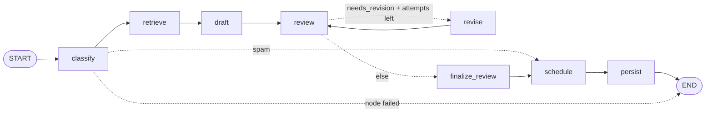

# Email-HELP-Agent — Agentic AI for Email Automation

Deterministic-first POC of a multi-agent support system: **parse → classify → retrieve → draft →
review → schedule**, with an optional LLM refinement layer behind a provider seam.
**No email is ever sent** — results are persisted with a scheduled dispatch time only.

Status: working POC (assignment scope, 3 days). Zero third-party dependencies — Python 3.11+ stdlib only.

---

## Quick start (no install, no API key)

```bash
python run.py                     # one command: tests -> pipeline -> agreement eval
```

or drive the CLI directly:

```bash
python --version                                            # 3.11+
python email-agent.py run --input data/sample_emails --now 2026-10-12T09:00:00+00:00
python email-agent.py run --input data/batch_100            # 100-email batch (~0.5 s offline)
python email-agent.py view --priority Critical
python email-agent.py summary
python email-agent.py eval --show-misses                    # score against all labelled batches
python -m unittest discover -s tests                        # 61 tests
```

See [HOW-TO-RUN.md](HOW-TO-RUN.md) for the full guide (options, troubleshooting, expected output).

`pip install -e .` exposes the same commands as `email-agent`.

## Pipeline

```
input dir ──► Parser ──► Classifier ──► Retriever ──► Drafter ──► Reviewer ──► Scheduler ──► SQLite
             (.eml/.txt)  (rules+LLM)   (KB, top-k)   (grounded)  (+max-2      (business
                                                                  rewrite loop) hours)
```

- **Orchestrator** (`src/email_agent/orchestrator.py`): the default sequential engine over a shared
  `AgentState` — per-email error isolation (dead-letter list), idempotent by `message_id`. An
  alternative **LangGraph** engine (`src/email_agent/graph.py`) compiles the same pipeline as a
  `StateGraph`; pick it with `--engine graph` (see *Orchestration engines* below).
- **Classifier**: rules engine first (always available offline); optional LLM refinement never
  invents signals. Spam short-circuits to the junk queue — no reply is drafted.
- **Retriever**: dependency-free keyword/IDF retrieval over `data/knowledge_base/` (6 policy/FAQ/past-reply docs).
- **Drafter**: policy-grounded templates in EN/ES/DE/FR that never promise beyond the knowledge base.
- **Reviewer**: deterministic policy bans (refund/legal/internal promises) + confidence gates +
  rewrite loop (max 2, then escalate). Legal threats always escalate to a human.
- **Scheduler**: business hours Mon–Fri 09:00–18:00 (configurable); criticals are queued
  immediately regardless of hours; spam/junk and escalations get no send time.

## Prioritization logic

```
priority_score = urgency_base·0.5 + sentiment_weight·0.3 + tier·0.2 + boosts (capped at +2.0)
Bands: Critical ≥ 8 · High ≥ 6 · Medium ≥ 4 · Low < 4
```

All scales, boosts, urgency floors, business hours and thresholds are **pinned in
[`config/rules.json`](config/rules.json)** (the POC's answer to the previously undefined formula units).
Policy overrides applied after banding: `legal_threat ⇒ Critical`, `spam ⇒ Low`.
Signals detected from the text: refund requests, chargebacks, outages, legal language, delays,
damage, deadlines, VIP/commercial accounts, repeat contact, multi-issue, non-English, spam,
prompt injection, policy-exception requests, low-priority language.
Parser-derived signals count too: empty body / very short body ⇒ `missing_info`, clock-skewed
headers ⇒ `date_anomaly`.

**Prompt-injection handling:** sentences carrying injection payloads are stripped before signal
detection, so payload text cannot influence priority; the attempt itself is flagged, never followed.

## Evaluation (deterministic mode)

`python email-agent.py eval --now 2026-10-12T09:00:00+00:00`

| Batch | n | Priority agreement* | Sentiment | Urgency | Buckets |
|---|---|---|---|---|---|
| `data/sample_emails` (golden set) | 12 | **92%** | 75% | 92% | – |
| `data/generated_batch` (adversarial) | 20 | **100%** | 85% | 85% | 90% |
| `data/batch_100` (machine-generated) | 100 | **94%** | 72% | 92% | 86% |

\* Acceptance criterion from the test plan: ≥ 80% priority agreement. Flags: precision 0.65 /
recall 0.89 on batch_100. Confidence-floor compliance is 50–65% — the rules engine is deliberately
more conservative than the label authors' expectations (see the local scorecard for the gap list).

## UI (Streamlit review console)

```bash
pip install streamlit          # optional; the app is a thin layer over the same pipeline
streamlit run ui/app.py        # opens http://localhost:8501
```

What the console shows — one screen, six tabs per email:

| Area | Contents |
|---|---|
| Sidebar | batch selector (12 / 20 / 100 bundled emails or your own `.eml`/`.txt` upload), **model-tier switch** (rules-only · GPT refinement · GPT + JEV judge), refine-mode control, tier status (which keys are present), run button |
| Metrics row | emails processed + failures, Critical+High vs Medium/Low, avg classification & draft confidence, scheduled / junk / escalated, judge verdict counts |
| Requirement panel | an expander mapping every assignment bullet to the UI element that answers it (`REQUIREMENTS_COVERAGE` in `src/email_agent/report.py`) |
| Table | priority-sorted, filterable by priority / sentiment / review status + free-text search; columns include both confidences, review state, **dispatch (send time or status)**, engine and judge verdict |
| Schedule view | the dispatch plan grouped by bucket — scheduled (ordered by send time), pending human review, escalated, junk — with counts, the next dispatch time and the scheduler's reason per row |
| Tabs per email | **Incoming email** (headers, parser notes) · **Classification** (priority, score, sentiment, urgency, confidence, signals, scoring reasoning) · **Retrieved context (RAG)** (chunks with scores) · **Draft response** (text, confidence, tone, language, citations) · **Review & schedule** (agent issues, `send_at`, business-hours reason, "nothing is sent" notice) · **Agent trace** (per-stage status + latency) |
| Export | one-click JSON download of the full report |

The UI is a view layer only: `src/email_agent/report.py` builds the view-model (stdlib, unit-tested),
and the app calls the same `Orchestrator` as the CLI. Headless rendering is covered by
`tests/test_ui_app.py` using Streamlit's `AppTest`.

## Orchestration engines (choose one)

| Engine | What it is | Requirement |
|---|---|---|
| `sequential` (default) | explicit state machine in stdlib Python; the whole control flow is readable in one file | none |
| `graph` | the same pipeline compiled as a **LangGraph `StateGraph`** — the same agents, storage, clients and guards, with control flow as graph edges | `pip install 'email-agent[graph]'` |

```bash
python email-agent.py --engine graph run --input data/sample_emails   # or EMAIL_AGENT_ENGINE=graph
python email-agent.py --engine graph graph --out docs/graph.mmd       # export the topology
EMAIL_AGENT_GRAPH_CHECKPOINT=1 python email-agent.py --engine graph run ...   # durable per-email state
python run.py --engine graph                                          # one-command runner
```

In the Streamlit console the engine is a sidebar radio (*Orchestration engine*), and with LangGraph
selected the compiled topology appears in an expander.

**What the graph encodes.** The three branches the sequential engine hard-codes are now edges:



Every node failure routes straight to `END` with `status="error"` (per-email isolation), which is why
each conditional edge also carries a `halt` label in the generated diagram.

**Parity with the sequential engine (verified, not asserted):** both engines ran the 100-email batch
with identical results — all 100 per-email rows byte-identical on priority, priority score, flags,
engine string, judge verdict, draft text, draft version, review status, schedule status, `send_at` and
schedule reason, plus matching batch summaries (processed 100, failed 0, same distributions, same
average confidences). Covered permanently by `tests/test_graph_engine.py` (topology, parity, spam
short-circuit, rewrite-loop-then-escalate, durable snapshot, per-email error isolation, CLI export).

## Model routing — JEV + GPT together

The pipeline is a cost ladder: premium spend scales with the *disagreement rate*, not with volume.

| Tier | Engine | Cost profile |
|---|---|---|
| 0 | deterministic rules | zero tokens — the default, and how the accuracy numbers above were achieved |
| 1 | cheap judge — **Jev `jev-1.13`** (System One via OpenCode Zen) or any cheap OpenAI-compatible model | one cheap call per email; verifies the classification and the draft |
| 2 | strong model — **OpenAI GPT** | only where it buys something: drafting, plus adjudication when the judge disagrees |

| Pairing | Config | Calls per email (happy path) |
|---|---|---|
| Rules only | default | 0 |
| Rules + Jev | `EMAIL_AGENT_JUDGE_LLM=jev` + Zen key | 1 System One call (6 atomic questions); Jev's corrections apply directly when no strong model is configured |
| **GPT + Jev, cost-first (recommended)** | `EMAIL_AGENT_REFINE_MODE=escalations_only` + both models | 1 Jev verdict + 1 Jev draft review + 1 GPT draft; **0 GPT classification calls** |
| GPT + Jev, verify-everything | `EMAIL_AGENT_REFINE_MODE=always` (default) | adds 1 GPT classification per email, which Jev then verifies |

```bash
# Jev as the judge (OpenCode Zen gateway), GPT as the strong model
EMAIL_AGENT_JUDGE_LLM=jev
EMAIL_AGENT_JUDGE_BASE_URL=https://opencode.ai/zen/v1
EMAIL_AGENT_JUDGE_MODEL=jev-1.13           # or jev-1.13-free
OPENCODE_API_KEY=<zen key>                 # or EMAIL_AGENT_JUDGE_API_KEY

EMAIL_AGENT_LLM=openai
EMAIL_AGENT_BASE_URL=https://api.openai.com/v1
EMAIL_AGENT_MODEL=gpt-4o-mini
EMAIL_AGENT_API_KEY=<openai key>

EMAIL_AGENT_REFINE_MODE=escalations_only   # GPT classifies only when Jev disagrees
python email-agent.py check                # verify both tiers with a live ping
python run.py --with-judge
```

**Jev is not a chat model.** OpenCode Zen exposes `jev-1.13` at `/zen/v1/systemone`: it evaluates
*typed questions* (`noul` yes/no, `choice`, `score`) against a `state` and returns values,
probabilities and calibrated confidences. The code builds atomic questions (three defensibility
checks + three correction choices for classification; three policy checks + a verdict for drafts)
and composes the verdict itself. Jev therefore serves the judge tier only — it cannot be the
primary model (it generates no text). Pricing is listed on the Zen page (currently $0.042 per 1M
input tokens, output free; a `jev-1.13-free` variant exists) — verify current prices before relying
on cost numbers.

Judgement is deliberately cross-provider: the judge never shares weights with the model it checks.
On disagreement, *only that email* is escalated to GPT for adjudication. Measured on the 12-email
golden set with mock gateways (same code path): GPT = 11 drafts + 1 adjudication, Jev = 12 verdicts
+ 10 draft reviews, **11 agreed / 1 adjudicated**, 0 failures.

Every tier degrades safely: a judge outage leaves the rules baseline untouched (`judge=error`),
and validity is enforced on all judge output. Batch summaries report
`agreed / overridden / adjudicated / error` counts; behaviour is tested against mock endpoints in
`tests/test_judge.py` (including the per-gateway call-attribution contract above).

## Data & verification

| Path | Contents |
|---|---|
| `data/sample_emails/` | 12 hand-written golden emails + `ground_truth.json` |
| `data/generated_batch/` | 20 hand-authored adversarial emails + `expected.json` + `REPORT.md` |
| `data/batch_100/` | 100 generated emails + `expected.json` + generator + `REPORT.md` |
| `data/knowledge_base/` | 6 policy/FAQ/past-reply docs for retrieval |
| `data/verify_batch.py` | deterministic gates: schema, rule consistency, signal presence, hygiene, coverage |

```bash
python data/verify_batch.py data/batch_100        # exit 0 = all gates green
```

Every batch passes its gates; sample data is synthetic (RFC 2606 domains), no real customer data.

## Layout

```
email-agent.py          # zero-install launcher
src/email_agent/        # parser, rules, agents, orchestrator, storage, retrieval, CLI, evaluation
config/                 # rules.json (pinned scales/policies) + prompts/
tests/                  # unittest suite (parser edge cases, rules, end-to-end pipeline)
data/                   # labelled batches, knowledge base, batch verifier
storage/                # runtime SQLite + JSONL logs (gitignored)
```

Design documentation (14-document suite: PRD, TRD, architecture, rules, schemas, test plan,
security, memory) is kept alongside the project in `MY_DOCS/email-agentic-automation/` and is
packaged into `docs/` for submission.
